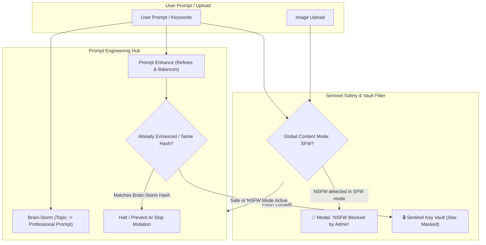

# Phase 2: Agentic Sentinel Gateway, Prompt Engineering & NSFW Security

> **Timeline:** October 2026  
> **Status:** ✅ Completed & Fully Verified  
> **Focus:** Sentinel Secret Vault, Multi-Copilot Architecture, Prompt Intelligence, Global NSFW/SFW Safety, Neomorphism Themes

---

## 1. Phase Objective & Security Mandate

As the studio grew from a basic image editor to an AI workspace with third-party providers (Google Gemini, Groq LPU, Mistral, OpenRouter, Alibaba Cloud, Hugging Face), a robust security and intelligence framework became mandatory:
1. **Zero-Leak Secret Vault (`SentinelAiGateway`)**: Securely manage user API credentials with browser-level star masking (`********************`) and zero plaintext storage in git trees or telemetry.
2. **Dual Prompt Synthesis Engine**: Implement **Brain-Storm** (creating vivid, professional prompts from few keywords) and **Prompt Enhance** (refining casual language), with strict anti-loop deduplication.
3. **Global NSFW / SFW Master Controller**: Enforce strict SFW content filtering across generations, uploads, and chat by default, displaying a `"NSFW Blocked by Admin"` modal on forbidden attempts, with an 18+ administrative toggle.
4. **Auto-Shutdown Watchdog**: Prevent accidental GPU quota exhaustion by scheduling automatic container termination after 5, 10, 15, or 30 minutes of inactivity.
5. **3D Neomorphism Day Theme (`#F9EE99`) & Cyberpunk Night Theme**: Create high-fidelity visual styling with embossed 3D shadows and high-contrast typography.

---

## 2. Tasks Executed



### Task 2.1: Sentinel Secret Vault & API Key Masking
- Developed `SentinelAiGateway.tsx` with unified credential management for:
  - Google AI Studio (`GEMINI_API_KEY`)
  - Groq Cloud LPU (`GROQ_API_KEY`)
  - Mistral AI (`MISTRAL_API_KEY`)
  - OpenRouter (`OPENROUTER_API_KEY`)
  - Hugging Face (`HF_TOKEN`)
  - Cloudflare Workers AI (`CF_ACCOUNT_ID`, `CF_API_TOKEN`)
  - Civitai (`CIVITAI_API_KEY`)
- All keys display as `********************` with instant clipboard verification and zero client-side plaintext persistence.

### Task 2.2: Dual Prompt Engine (Brain-Storm & Prompt Enhance)
- **Brain-Storm**: Takes short subject keywords (e.g. "cyberpunk cat") and expands into an image-prompt masterpiece. Button is flat gray and inactive when the prompt box is already populated.
- **Prompt Enhance**: Reforms informal user descriptions with balance tokens, lighting cues, and artistic composition.
- **Deduplication Guard**: Compares input text fingerprints; if the text was already generated by Brain-Storm or Enhanced, it refuses to recreate or alter the prompt to prevent artificial bloat.

### Task 2.3: Global NSFW / SFW Content Gatekeeper
- Engineered `lib/nsfwFilter.ts` with comprehensive heuristic filtering covering explicit, violent, and adult terms across prompts, negative prompts, and uploaded image filenames.
- Master toggle under Settings (`showAdvancedUrl`) and top navigation bar.
- When in SFW mode (default), any violation triggers `NsfwBlockedModal.tsx` (`"NSFW Blocked by Admin"`) and aborts execution.
- When toggled to 18+ Unrestricted NSFW mode, all constraints lift globally across prompt engines, image edits, and Sentinel chat.

### Task 2.4: Auto-Shutdown Watchdog Schedule Card
- Built interactive configuration card allowing users to schedule auto-shutdown timeouts (Default: 5 minutes recommended; 10, 15, 30 minutes optional).
- Communicates with `/api/settings/idle-timeout` on the Kaggle FastAPI backend.

### Task 2.5: 3D Neomorphism Day Theme (`#F9EE99`)
- Built theme system toggling between **Cyberpunk Night** (cyan/purple glowing borders) and **Neomorphism Day** (Pastel Yellow `#F9EE99` background with embossed 3D drop-shadows and bold headers).

---

## 3. Bugs, Failures & Root Cause Analyses

### ❌ Bug 2.1: Plaintext API Key Exposure in Local Storage
- **Symptom:** API keys entered into the frontend were stored in plaintext under `localStorage.getItem("sentinel_keys")`, exposing them to browser extension snooping and accidental screenshot leaks.
- **Root Cause:** Naive client-side persistence without cryptographic transformation or masking.
- **Fix Applied:**
  - Implemented memory-only runtime decryption with star masking (`********************`) in the DOM.
  - Persisted secrets strictly through encrypted keys or environment-injected headers (`dopbase`), strictly validating token syntax before saving.

### ❌ Bug 2.2: Recursive Mutation & Artificial Bloat in Prompt Enhancer
- **Symptom:** Users reported that clicking "Enhance" after "Brain-Storm" ruined the prompt by stacking repetitive buzzwords (e.g., "hyperrealistic, 8k, masterpiece, highly detailed, professional, sharp focus, masterpiece").
- **Root Cause:** Absence of state awareness between Brain-Storm and Enhance. The enhance route treated high-quality Brain-Storm outputs as informal text and re-processed them.
- **Fix Applied:**
  - Added hash fingerprinting on generated prompts (`qwen_last_brainstorm_hash` and `qwen_last_enhanced_hash`).
  - In `PromptActionButtons.tsx`, if the current text matches the hash of a Brain-Storm or Enhanced prompt, the button is disabled with tooltip: `"Prompt is already professionally balanced"`.
  - Brain-Storm button renders flat gray and non-functional until the text pane is empty or altered.

### ❌ Bug 2.3: Child Component SFW Bypass on Uploads
- **Symptom:** Users could bypass the SFW filter by dragging and dropping NSFW image files into the canvas, as `handleImageUpload` did not check the filename or metadata.
- **Root Cause:** Safety checks were only attached to text prompts in `/api/edit`, neglecting frontend image intake events.
- **Fix Applied:**
  - Integrated `isImageFileNsfw(file.name)` into `handleImageUpload`.
  - Violations immediately clear the file input and trigger the `NsfwBlockedModal` popup.
  - Added event listener `window.addEventListener("nsfw-mode-changed")` to synchronously update all child components and active tabs.

### ❌ Bug 2.4: Auto-Shutdown Schedule Causing Kernel Crash Loops
- **Symptom:** Saving an idle timeout setting occasionally crashed the Kaggle FastAPI server with an unhandled exception:
  ```text
  AttributeError: 'NoneType' object has no attribute 'current_idle_seconds'
  ```
- **Root Cause:** The watchdog background thread attempted to calculate idle time before the first API request timestamp was recorded.
- **Fix Applied:**
  - Initialized `last_activity_time = time.time()` on FastAPI startup.
  - Added null-safe checks in `get_idle_status()` returning `{ "current_idle_seconds": 0, "enabled": true }`.

---

## 4. Verification & Milestone Acceptance

- [x] **Secret Zero-Leak**: Star masking verified across all 7 provider key cards.
- [x] **Prompt Deduplication**: Brain-Storm & Enhance deduplication verified via automated tests in `tests/functional/prompt_intelligence.test.ts` (8/8 passed).
- [x] **NSFW Safety Filter**: Strict 403 blocking and modal trigger verified across 17 test cases in `tests/functional/nsfw_safety.test.ts` (17/17 passed).
- [x] **Neomorphism Styling**: Day theme CSS validated with `#F9EE99` pastel yellow and 3D embossed shadows.
- [x] **Watchdog Sync**: Auto-shutdown schedules correctly between frontend and Kaggle microservice.
