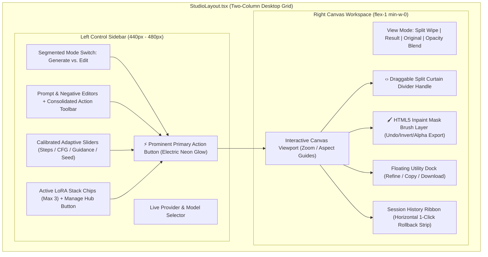

# Phase 4: Modern Two-Column Studio Workspace & Interactive Canvas

> **Timeline:** October 2026  
> **Status:** ✅ Completed & Fully Verified  
> **Focus:** Two-Column Split-Pane Studio, Interactive Curtain Wipe, HTML5 Inpaint Layer Masking, Multi-LoRA Stacking, Adaptive Slider Calibration

---

## 1. Phase Objective & UX Audit

A rigorous user experience and information architecture audit revealed critical usability friction in the initial studio design:
1. **Vertical Scroll Exhaustion**: The settings panel, prompt boxes, LoRA controls, and generation buttons were stacked vertically above the canvas. Users had to repeatedly scroll up and down between tweaking parameters and reviewing the generated output.
2. **Sliders Inverted & Locked at 1**: True-CFG Scale, Guidance Scale, and Inference Steps all initialized to `1.0`, producing corrupted, degraded images for non-distilled models.
3. **LoRA Clutter & Duplication**: The LoRA selector was a single raw `<select>` dropdown rendering truncated raw filenames, while all 27 cached LoRAs were printed a second time in a massive list beneath the canvas.
4. **Weak Primary Action Hierarchy**: The main trigger (`Apply Image Edit`) visually blended into secondary helpers (`Enhance`, `Seed`).
5. **Passive Canvas**: The preview area was static display-only with basic Result/Original buttons, lacking inpainting, split comparison, or aspect-ratio presets.

---

## 2. Mandatory Safety Protocol Executed

Before any code refactoring commenced:
1. Created an emergency git baseline branch: `backup/pre-studio-redesign-stable` at commit `fa7b15b`.
2. Created and checked out the active feature branch: `feature/studio-modern-redesign`.
3. Established zero-breakage constraint: All existing API contracts (`/api/edit`, `/api/generate`, `/api/sentinel/*`, `/api/tunnel`) and all 57 automated tests had to remain 100% passing.

---

## 3. Architecture Decomposed & Components Delivered



### Component 1: `StudioLayout.tsx`
- Responsive 2-column desktop grid (`lg:grid-cols-[440px_1fr] xl:grid-cols-[480px_1fr]`).
- Left column scrolls smoothly with hidden scrollbars; right column flex-grows to maximize viewport real estate.
- Gracefully degrades to a single stacked column on mobile devices (`< 1024px`) with zero horizontal overflow.

### Component 2: `ControlPanel.tsx`
- **Segmented Mode Toggle**: Equal-sized buttons for `🎨 Generate Image` and `✨ Edit Image`.
- **Consolidated Prompt Toolbar**: Integrated Brain-Storm, Prompt Enhance, Inspire, and Smart-Negative directly into the prompt header.
- **Model-Calibrated Adaptive Sliders**:
  - Automatically calibrates parameters upon model selection:
    - **Distilled / Turbo / Viggle / Schnell**: Steps: `4–6`, CFG: `1.0`, Guidance: `1.0–1.5`, Rapid presets (`4`, `6`, `8`, `12`).
    - **Standard Diffusion / SDXL / Qwen Base / Cloud**: Steps: `25`, CFG: `6.0`, Guidance: `5.0`, Standard presets (`15`, `20`, `25`, `30`).
- **Prominent Primary CTA**: Full-width high-contrast electric gradient button (`animate-neon-button`) with step counters, elapsed timers, and emergency Cloud fallback if generation takes >45s.

### Component 3: `CanvasWorkspace.tsx`
- **Interactive Split Curtain Wipe Slider**:
  - Real-time before/after comparison with a draggable vertical divider handle (`‹›`).
  - Supports mouse and touch dragging across the canvas (0% to 100%).
- **HTML5 Inpaint Masking Layer**:
  - Overlaid canvas synced with the image's `naturalWidth` and `naturalHeight`.
  - Adjustable brush radius (`6px` to `70px`), rounded stroke joints (`lineCap = "round"`), undo history stack, mask inversion, and binary alpha mask export passed to `/api/edit`.
- **Zoom & Pan Controls**: 50%, 75%, 100%, 150%, 200%, and Fit to Screen.
- **Aspect Ratio Guides**: 1:1 (Square), 16:9 (Landscape), 9:16 (Stories/Shorts), 4:5 (Social).
- **Utility Dock**: 1-click "Refine" (send result to input for iterative editing), Copy to Clipboard, and Download PNG.

### Component 4: `LoraModal.tsx`
- Replaced the single `<select>` dropdown and eliminated the redundant 27-item list below the old canvas.
- Features search bar, category badges (SDXL, Flux, Qwen, Style, Character), size metrics, and trigger words preview.
- **1-Click Trigger Word Injection**: Appends required trigger tokens directly into the prompt box.
- **Multi-LoRA Stacking**: Combines up to 3 LoRAs simultaneously with individual weight sliders (`0.0` to `1.5`).

### Component 5: `HistoryRibbon.tsx`
- Horizontal thumbnail strip at the bottom of the studio displaying recent generation outputs.
- Hover overlay with 1-click **View** (load to canvas) and 1-click **Branch / Refine** (send as input image for the next edit iteration).

---

## 4. Bugs, Failures & Root Cause Analyses

### ❌ Bug 4.1: Vertical Layout Friction & Scrolling Fatigue
- **Symptom:** Users had to scroll down 600px to see the image result, then scroll back up to alter the prompt or steps.
- **Root Cause:** A single-column vertical layout (`grid-cols-12` stacked vertically on medium screens) with fixed aspect ratios.
- **Fix Applied:**
  - Transitioned to the desktop split-pane (`StudioLayout.tsx`). The controls stay fixed and accessible on the left while the canvas stays in view on the right at all times.

### ❌ Bug 4.2: Inference Sliders Locked at 1.0 Default
- **Symptom:** When users switched between Turbo and SDXL models, the sliders stayed locked at `1.0` CFG and `1` step, causing diffusion models to output pure noise or black images.
- **Root Cause:** Hardcoded static initial state (`useState(1.0)`) without model-change awareness.
- **Fix Applied:**
  - Implemented `applyModelCalibratedDefaults(modelId)` in `ControlPanel.tsx`, which dynamically inspects model architecture tags and applies calibrated step/CFG profiles upon every model switch.

### ❌ Bug 4.3: Duplicate 27-LoRA List Cluttering DOM
- **Symptom:** All 27 LoRAs were rendered twice in the page: once inside the native `<select>` dropdown, and again in a 380px vertical scroll container on the right, consuming viewport space.
- **Root Cause:** Redundant component duplication in `app/page.tsx`.
- **Fix Applied:**
  - Consolidated all LoRA operations into `LoraModal.tsx`. The main control panel now displays compact chips for only the active stacked LoRAs (up to 3).

### ❌ Bug 4.4: Inpaint Mask Coordinate Mismatch
- **Symptom:** Painting a mask on an image resized by CSS caused the inpainting mask to be offset or stretched relative to the real image.
- **Root Cause:** Drawing directly on a canvas sized to DOM `clientWidth`/`clientHeight` instead of the image's `naturalWidth`/`naturalHeight`.
- **Fix Applied:**
  - Sized the canvas dynamically to `image.naturalWidth` and `image.naturalHeight`.
  - Applied coordinate transformation scaling:
    ```typescript
    const scaleX = canvas.width / rect.width;
    const scaleY = canvas.height / rect.height;
    return {
      x: (e.clientX - rect.left) * scaleX,
      y: (e.clientY - rect.top) * scaleY
    };
    ```

---

## 5. Verification & Milestone Acceptance

- [x] **Zero TypeScript Errors**: `npm run typecheck` exited with code 0.
- [x] **Automated Test Suite**: All 57 tests passing across 7 test suites (`npm test`).
- [x] **Production Build**: `npm run build` compiled 12/12 routes cleanly with Next.js 15.5.
- [x] **Code Reduction**: Decoupled `app/page.tsx` by over 650 lines of monolithic code into clean, isolated modules.
- [x] **Git Checkpoint**: Committed to `feature/studio-modern-redesign` under hash `4256ecb`.

---

## 6. Studio Polish Pass & Viewport Optimization

### 6.1 Expanded Empty State Canvas Dropzone
- **Component**: `CanvasWorkspace.tsx`
- **Enhancement**: Replaced compact empty placeholder with an expanded, high-visibility dashed dropzone (`max-w-xl h-80 border-2 border-dashed border-slate-700/80 rounded-2xl bg-slate-900/40 hover:border-cyan-500/50 hover:bg-slate-900/60 transition-all cursor-pointer`) giving users an immediate, tactile drag-and-drop target.

### 6.2 Primary CTA Accessibility & Visual Hierarchy
- **Component**: `ControlPanel.tsx`
- **Enhancements**:
  - **Electric Gradient**: Enabled state styled with `bg-gradient-to-r from-cyan-500 to-blue-600 hover:from-cyan-400 hover:to-blue-500 text-white font-semibold shadow-lg shadow-cyan-500/20 active:scale-[0.99]`.
  - **Contextual Tooltip & Helper Note**: When in Edit mode with no image uploaded, the button displays a native `title="Upload an image to enable editing"` tooltip alongside a subtle helper message (`<p className="text-[11px] text-slate-400 text-center font-medium">Upload an image to enable editing</p>`).

### 6.3 Independent Left Sidebar Scroll (Stationary Canvas)
- **Component**: `StudioLayout.tsx`
- **Enhancement**: Applied `w-full h-[calc(100vh-64px)] overflow-y-auto scrollbar-thin scrollbar-thumb-slate-800 pr-2 pb-8 flex flex-col gap-4` to the left `<aside>`. This allows the user to scroll through complex model settings, LoRAs, and prompt parameters while the right canvas workspace remains anchored and stationary in the desktop viewport.

