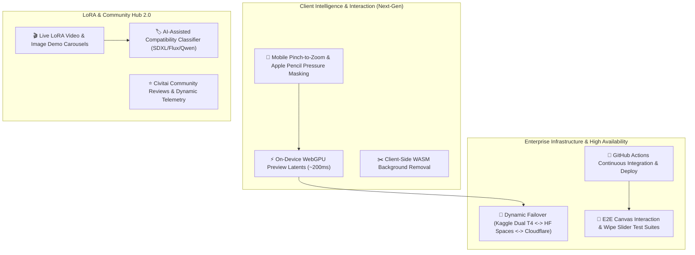

# Phase 5: Future Roadmap & Scaling Horizons

> **Timeline:** Q4 2026 – Q1 2027  
> **Status:** 🚀 Active Roadmap & Planned Implementations  
> **Focus:** Mobile Multi-Touch Gestures, WebGPU Client Previews, Auto-CI/CD, Multi-Node GPU Clustering

---

## 1. Vision & Expansion Objectives

Following the successful deployment of the **Two-Column Split-Pane Studio Workspace (Phase 4)**, the development roadmap for **Phase 5** centers on expanding performance, accessibility, on-device intelligence, and automated deployment pipelines:

---

## 2. Milestone Initiatives & Detailed Technical Specifications

### Milestone 5.1: Mobile Multi-Touch Gestures & Stylus Pressure Masking
- **Target Goal**: Elevate mobile and tablet editing to desktop parity.
- **Features**:
  - Two-finger pinch-to-zoom and smooth panning across mobile viewports (360px to 840px).
  - Apple Pencil and Android stylus pressure sensitivity: dynamically scale mask brush thickness based on pointer pressure (`e.pressure`).
  - Eraser brush mode and polygonal lasso masking tool for precision region selection.

### Milestone 5.2: Client-Side WebGPU / WASM Fast Latent Preview
- **Target Goal**: Provide instant visual feedback before waiting for remote GPU inference.
- **Features**:
  - Integrate ONNX Runtime Web / WebGPU to synthesize lightweight preview sketches on the client machine in ~200ms.
  - Implement client-side `rembg-wasm` (background removal) directly within the canvas floating utility dock.

### Milestone 5.3: Civitai Community Media & Dynamic Rating Carousels
- **Target Goal**: Enrich the `LoraModal` drawer with full community metadata.
- **Features**:
  - Multi-image and short video preview carousels for each cached LoRA.
  - Live Civitai star ratings, download statistics, and author attribution badges.
  - Automated compatibility validation: checks base model architecture (SDXL, Flux, Qwen) against the active generator model before fusing.

### Milestone 5.4: Automated End-to-End Test Suite (Playwright)
- **Target Goal**: Continuous automated regression testing for complex canvas and modal interactions.
- **Features**:
  - Headless browser simulation of canvas brush strokes, undo/clear actions, and mask alpha export.
  - Automated drag-testing of the Before/After split curtain wipe slider across multiple screen resolutions.
  - Secret vault verification: ensures zero key leakage in DOM elements, network payloads, or storage.

### Milestone 5.5: Multi-Cloud GPU Clustering & Automated Failover
- **Target Goal**: Zero downtime even when Kaggle quotas expire or tunnels disconnect.
- **Features**:
  - Smart Ingress Gateway: If Kaggle Dual T4s are warming up or quota exhausted, seamlessly route edit requests to Hugging Face GPU Spaces or Cloudflare Workers AI with identical prompt and LoRA parameters.
  - Automated GitHub Actions deployment pipeline: lint, test, and deploy to Vercel on `main` merge.

---

## 3. Anticipated Challenges & Preemptive Mitigation Strategies

| Challenge | Risk Profile | Preemptive Mitigation Strategy |
| :--- | :--- | :--- |
| **Mobile Canvas Touch Latency** | High input lag during mask painting on low-power mobile devices. | Implement `requestAnimationFrame` debouncing and offscreen canvas rendering buffers. |
| **WebGPU Browser Compatibility** | Inconsistent WebGPU support on older Android devices or Safari. | Feature-detect `navigator.gpu`; gracefully fall back to CPU WASM or standard remote server preview. |
| **Civitai Thumbnail Rate Limits** | Civitai image CDN rate-limiting mass thumbnail downloads in `LoraModal`. | Cache and proxy thumbnail images through Google Drive Vault (`AI_Storage/loras/thumbnails/`). |

---

## 4. Acceptance Criteria & Phase 5 Sign-Off Checklist

- [ ] Mobile pinch-to-zoom and stylus pressure sensitivity operational.
- [ ] Client-side background removal operational with zero server roundtrips.
- [ ] Playwright E2E test suite running in GitHub Actions with 100% pass rate.
- [ ] Multi-cloud automatic failover between Kaggle Dual T4 and Cloud AI verified.
