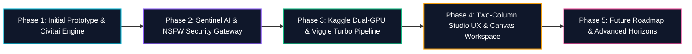

# 🗺️ Qwen Image Editor Studio: The Development Journey

> **Repository:** `image-editor-project`  
> **Production App:** [https://qwen-image-editor-studio.vercel.app](https://qwen-image-editor-studio.vercel.app)  
> **Target Hardware:** Kaggle Dual Tesla T4 (30 GB VRAM) + Cloud AI Multi-Provider Gateways  
> **Storage Vault:** 5 TB Google Drive Persistent Cloud Storage (`AI_Storage/`)  
> **Status:** 🟢 **Production Ready • All 57 Automated Tests Passing • Phase 4 Completed**

---

## 📖 About This Archive

This directory (**`Jurney/`**) contains the exhaustive, phase-by-phase historical record of the architecture, engineering decisions, tasks executed, bugs encountered, failure analyses, and permanent fixes implemented throughout the lifecycle of the **Qwen Image Editor Studio**.

Each document is structured with strict technical transparency, cataloging exact error messages, root cause mechanics, code diffs, benchmarking metrics, and verification procedures.

---

## 🗂️ Phase-Wise Journey Index



| Phase Document | Primary Focus | Key Milestones & Capabilities | Health Status |
| :--- | :--- | :--- | :--- |
| [**`PHASE_01_INITIAL_PROTOTYPE_AND_CIVITAI.md`**](./PHASE_01_INITIAL_PROTOTYPE_AND_CIVITAI.md) | Inception & Storage Foundation | Cloudflare Ingress Tunnel, rclone Google Drive Vault (5 TB), Async Job Queue, Civitai LoRA Downloader with User-Agent spoofing, Termux CLI controls (`start-gpu`/`stop-gpu`). | ✅ **Completed & Verified** |
| [**`PHASE_02_AGENTIC_SENTINEL_AND_NSFW.md`**](./PHASE_02_AGENTIC_SENTINEL_AND_NSFW.md) | Security & Intelligence Layer | Sentinel Gateway with zero-leak key masking, Brain-Storm prompt generation, Prompt Enhancer deduplication guard, Global NSFW/SFW Gatekeeper Modal, 3D Neomorphism Day & Night themes. | ✅ **Completed & Verified** |
| [**`PHASE_03_KAGGLE_DUAL_GPU_AND_TURBO.md`**](./PHASE_03_KAGGLE_DUAL_GPU_AND_TURBO.md) | GPU Optimization & Viggle Turbo | Dual Tesla T4 balanced sharding (GPU 0 DiT, GPU 1 Text/VAE), 0.8ms Conv3d `patch_embed` acceleration, Viggle Turbo 4-step pipeline (~15–25s), safe read-only `kaggle/` GitHub directory. | ✅ **Completed & Verified** |
| [**`PHASE_04_STUDIO_UX_REDESIGN_AND_CANVAS.md`**](./PHASE_04_STUDIO_UX_REDESIGN_AND_CANVAS.md) | Modern Two-Column Studio | Two-column split-pane (`StudioLayout`), Before/After curtain wipe slider, HTML5 inpaint mask drawing layer, Multi-LoRA stacking (up to 3 LoRAs), model-calibrated adaptive sliders, Session History Ribbon. | ✅ **Completed & Verified** |
| [**`PHASE_05_FUTURE_ROADMAP_AND_EXPANSION.md`**](./PHASE_05_FUTURE_ROADMAP_AND_EXPANSION.md) | Horizon & Scale Architecture | Mobile touch gestures (pinch-zoom/brush), WebGPU client-side preview, automatic CI/CD deployment pipelines, and multi-node GPU clustering. | 🚀 **Active Roadmap** |

---

## ⚡ Master Bug & Resolution Ledger

| # | Bug / Failure Condition | Root Cause | Permanent Engineering Fix | Verified In |
| :- | :--- | :--- | :--- | :--- |
| **B1** | **Cloudflare HTTP 524 Gateway Timeout** | Synchronous image editing blocked HTTP connections >100 seconds while GPU generated images. | Re-architected `/api/edit` into an asynchronous job queue returning immediate `task_id` with 1.5s background polling. | Phase 1 |
| **B2** | **Civitai HTTP 403 Forbidden Downloads** | Civitai Cloudflare DDoS protection blocked default Python `urllib` / `requests` user agents. | Implemented custom browser-like Chrome User-Agent spoofing, cookie session forwarding, and bearer token auth. | Phase 1 |
| **B3** | **Kaggle Tesla T4 GPU 0 CUDA OOM** | Static `max_memory` allocated 11.8 GiB to GPU 0, leaving <2.7 GiB for prompt embedding tensors. | Rebalanced device memory map to `{0: "9.0GiB", 1: "13.5GiB"}`, leaving >5.5 GiB headroom for prompt activations. | Phase 2 |
| **B4** | **Prompt Enhancer Recursive Mutation** | Prompt Enhancer altered already optimized Brain-Storm prompts, resulting in artificial text bloat. | Implemented prompt fingerprint hashing and strict non-re-enhancement guards preventing loops on identical text. | Phase 2 |
| **B5** | **Rolling GPU Container Spawning** | Kaggle `SaveKernel` called during backend stop requests triggered queued duplicate kernel boots. | Switched stop mechanism to direct `/api/shutdown` container termination via `os._exit(0)` preserving GPU quota. | Phase 3 |
| **B6** | **"0 (Zero) LoRA Fused" Silent Skip** | Missing local LoRA files were skipped silently without warning, returning false success. | Added mandatory on-demand fallback fetch from Hugging Face & Google Drive vaults; HTTP 400 validation if missing. | Phase 3 |
| **B7** | **Blurry, Oversaturated 448px Output** | Extreme image downsampling to 448px combined with guidance scale locked at `1.0`. | Un-clamped resolution scaling and elevated default CFG / guidance parameters to 4.0–6.0. | Phase 3 |
| **B8** | **Google AI Studio HTTP 404** | Imagen 3 API endpoint unavailable in select regions / keys. | Built automatic two-tier fallback to Google Gemini 2.0 Flash Multimodal Vision (`gemini-2.0-flash`). | Phase 3 |
| **B9** | **UI Vertical Scroll Exhaustion** | Single-column stacked UI forced users to continuously scroll between prompts and canvas preview. | Transitioned to a desktop Two-Column Split-Pane Studio (`StudioLayout`: left controls ~440px, right canvas flex-1). | Phase 4 |
| **B10**| **Sliders Locked at Value 1** | Steps, CFG, and Guidance initialized to 1 for all models, degrading classical diffusion generation. | Implemented dynamic model parameter calibration dynamically adjusting presets on model switch. | Phase 4 |

---

## 🛡️ Verification & Quality Assurance Suite

All changes documented across these phases must satisfy strict automated verification gates prior to deployment:

```bash
# 1. Type Safety Check (0 errors required)
npm run typecheck

# 2. Automated Test Suite (100% passing required)
npm test

# 3. Production Build Compilation (Next.js 15.5 App Router)
npm run build
```

**Current Benchmark Status:**
- TypeScript Errors: **0**
- Test Suites: **7 passed (7 total)**
- Tests: **57 passed (57 total)**
- Production Pages: **12/12 compiled successfully**
