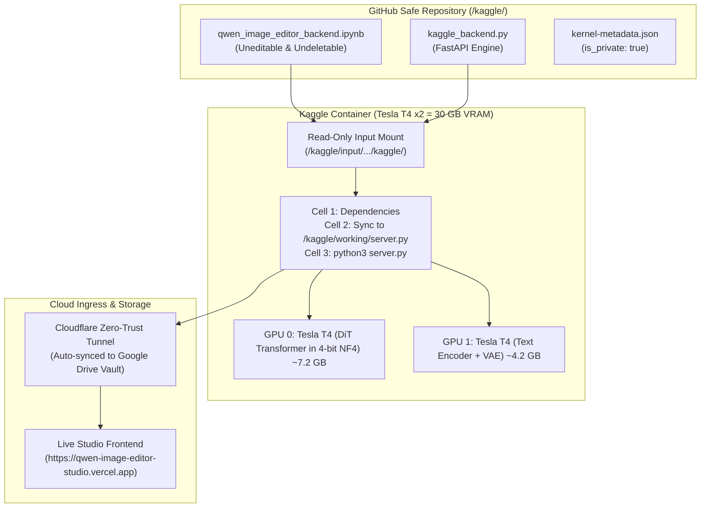

# 🚀 Kaggle Dual Tesla T4 Workstation Engine

[-00f2fe?style=for-the-badge&logo=nvidia)](https://www.kaggle.com)
[](https://huggingface.co/Viggle/Qwen-Image-2.1-viggle-turbo)
[](https://github.com/motherskitchenblr2/Qwen--Image-Editor-Civitai-Version)

A production-grade, uneditable, and undeletable execution package for the **Qwen Image Editor Studio** on Kaggle.

---

## 🛡️ Why Use this Repository Copy on Kaggle?

> [!IMPORTANT]
> **Accident Prevention & Git Immobility:**  
> When you link this GitHub repository directly into Kaggle as an external input or Git-backed script:
> - **Read-Only Filesystem:** Kaggle mounts linked GitHub repository files inside `/kaggle/input/...` as **strictly uneditable and undeletable**.
> - **Zero Accidental Overwrites:** You or any collaborator cannot accidentally modify, corrupt, or delete the runtime backend code from inside the Kaggle notebook UI.
> - **Single Source of Truth:** All updates are safely committed and reviewed on GitHub first, then cleanly pulled into Kaggle with deterministic versioning.

---

## ⚡ Execution Architecture



---

## 📋 How to Link this Repository in Kaggle (Step-by-Step)

### Option A: Direct Git Integration (Recommended for Safety)
1. Open [Kaggle](https://www.kaggle.com) and click **Create** &rarr; **New Notebook**.
2. In the notebook editor menu, click **File** &rarr; **Link to Git Repository** (or **GitHub** in the sidebar).
3. Select this repository: `motherskitchenblr2/Qwen--Image-Editor-Civitai-Version`.
4. Point to the notebook path:  
   `kaggle/qwen_image_editor_backend.ipynb`
5. The notebook will open in **read-only / tracked mode**, preventing accidental in-browser code alterations.

### Option B: Add as Read-Only Input
1. In your Kaggle notebook session, open the right-hand **Notebook Options** panel.
2. Click **Add Input** &rarr; **GitHub Repositories**.
3. Paste: `https://github.com/motherskitchenblr2/Qwen--Image-Editor-Civitai-Version.git`.
4. Run the uneditable script directly from the mounted input path:
   ```bash
   python3 /kaggle/input/qwen-image-editor-civitai-version/kaggle/kaggle_backend.py
   ```

---

## ⚙️ Kaggle Session Settings Checklist

Ensure the following toggles are set in the right-hand **Notebook Settings** panel before running:

| Setting | Required Value | Rationale |
| :--- | :--- | :--- |
| **Accelerator** | **GPU T4 x2** (Dual Tesla T4) | Distributes DiT to GPU 0 and Text Encoder + VAE to GPU 1 |
| **Internet** | **Internet On** | Required to pull Cloudflare ingress, HF weights, and Civitai LoRAs |
| **Persistence** | **Files only** | Keeps cache between fast reboots |
| **Environment** | **Always use latest environment** | Ensures up-to-date PyTorch 2.x and CUDA 12.x drivers |

---

## 🚀 What Happens When You Run Cell 3?

1. **Dual-GPU Balancing:**  
   Loads 4-bit NF4 weights cleanly split between GPU 0 (Transformer ~7.2 GB) and GPU 1 (Text Encoder + VAE ~4.2 GB). Both GPUs maintain **> 7 GB of free headroom**, preventing CUDA OOMs.
2. **0.8ms Patch Embed Acceleration:**  
   Replaces cuDNN's slow 30-second `nn.Conv3d` fallback with a direct matrix multiplication.
3. **Distilled 6-Step / 9-Step Viggle Turbo Pipeline:**  
   Runs with custom `raw_nodes` Euler sigma scheduling and strict `true_cfg_scale = 1.0` (zero-CFG), avoiding color saturation and blur.
4. **Zero-Touch Auto-Discovery:**  
   Generates a Cloudflare Zero-Trust tunnel URL and auto-posts it to your Google Drive Vault (`AI_Storage/configs/tunnel_url.txt`). Your Vercel Web Studio detects it within seconds and auto-connects!
5. **Inactivity Watchdog:**  
   Monitors GPU activity and automatically shuts down after 20 minutes of idle time to safeguard your weekly Kaggle quota.
